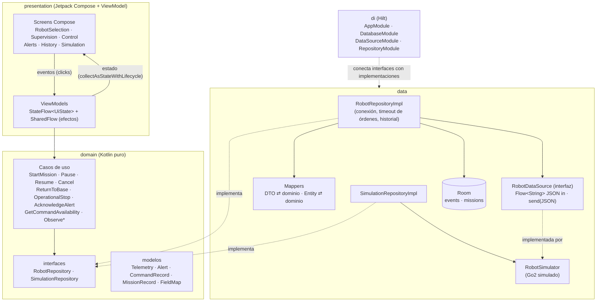
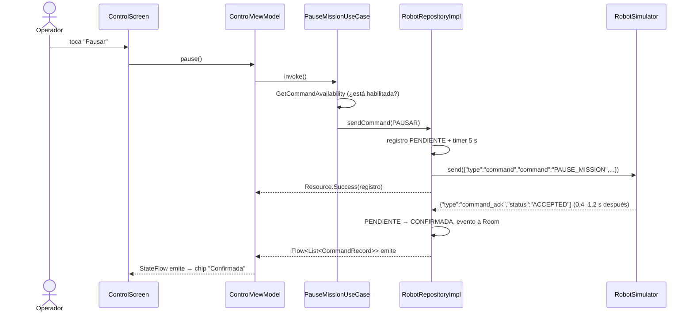

# Arquitectura

Clean Architecture + MVVM, igual que el proyecto de la cátedra (PokeDex Academy), con una diferencia:
en vez de una API REST con Retrofit, del otro lado hay un **robot simulado** que habla en JSON.



## Reglas que respetamos

| Regla | Cómo se cumple |
|---|---|
| La UI observa estado y manda eventos, **sin tocar el simulador** | Las pantallas solo conocen ViewModels; los ViewModels solo casos de uso. Ni siquiera el panel de simulación ve `RobotSimulator`: pasa por `SimulationRepository`. |
| Un **Repository** desacopla telemetría, comandos y eventos de la implementación simulada | `RobotRepository` (dominio) ← `RobotRepositoryImpl` (data) → `RobotDataSource` ← `RobotSimulator`. Cambiar a un robot real = otra implementación de `RobotDataSource` + 1 línea en `DataSourceModule`. |
| Separar modelos, Repository, ViewModel y Compose | Paquetes `domain/model`, `domain/repository`, `data/repository`, `presentation/<feature>/*ViewModel.kt` y `*Screen.kt`. |
| StateFlow | Cada ViewModel expone `StateFlow<UiState<T>>` (backing property privada) y `SharedFlow` para snackbars/navegación. |
| Persistencia local | Room: tabla `events` (todo lo que pasa) y `missions` (resumen al terminar cada misión). |
| Funciona sin robot, servidor ni internet | El manifest no pide permiso de INTERNET. |

## Flujo de una orden



## Estructura de paquetes

```
app/src/main/java/com/tprobot/ovejero/
 ├── core/            model (Resource, UiState), navigation (Screen), theme, coroutines (ApplicationScope)
 ├── domain/          model, repository (interfaces), usecase (1 clase = 1 acción)
 ├── data/
 │    ├── remote/     RobotDataSource, RobotProtocol, dto/ (contrato JSON)
 │    ├── simulator/  RobotSimulator (el Go2 simulado)
 │    ├── local/      Room: OvejeroDatabase, dao/, entity/
 │    ├── mapper/     Telemetry, Alert, Command, Robot, History
 │    └── repository/ RobotRepositoryImpl, SimulationRepositoryImpl
 ├── presentation/    robotselection, supervision, control, alerts, history, simulation, shell, common/
 └── di/              AppModule, DatabaseModule, DataSourceModule, RepositoryModule
```
